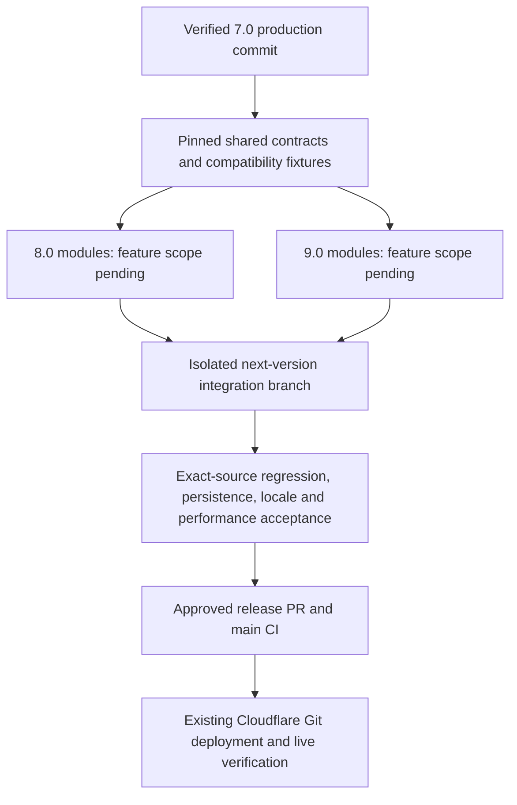

# Post-Gold parallel development contract

Status: preparation only. No 8.0–15.0 feature is implemented, enabled or authorized for production by this document. The release owner must first complete 7.0 Gold's exact-source acceptance, PR/main CI, existing Cloudflare publication and live verification. Owner physical acceptance is recorded separately.

The current request supplies version numbers, but no approved feature scope for 8.0 or 9.0. The dependency map below therefore describes engineering dependencies, not invented product commitments. Feature-specific dependencies must be added when those scopes are available.

## Shared data and behavior

| Surface            | Authoritative contract                                                                                                                                    | Parallel change rule                                                                                                                                                                                                          |
| ------------------ | --------------------------------------------------------------------------------------------------------------------------------------------------------- | ----------------------------------------------------------------------------------------------------------------------------------------------------------------------------------------------------------------------------- |
| Simulation         | `engine.mjs`: `createGame`, `resolveAction(state, actionId, payload)`, `validateState`, `migrateState`; successful commands return `{state, ok, message}` | Commands own mutations. Views never charge money, advance time, consume RNG or alter NPC knowledge. Preserve deterministic replay and immutable caller state.                                                                 |
| Identity and time  | Existing persisted entity/event IDs, revision, simulation clock and RNG state                                                                             | Preserve meaning, uniqueness, ordering and references. Never use wall-clock randomness for simulation decisions. New IDs require a module namespace and collision tests.                                                      |
| Persistence        | `persistence.mjs`; schema 6; canonical primary/backup; immutable v1–v5 archives                                                                           | Product version is not save schema version. No branch independently increments schema or rewrites slots. A future schema change is a separately reviewed migration contract before implementation.                            |
| Envelope           | Exact `{format, version, checksum, payload}`; supported dictionary codec 1                                                                                | Preserve validation/checksum and complete lossless round-trip. Unknown future schemas fail safely. No silently dropped historical data or new fields that the prior reader cannot preserve.                                   |
| Concurrent writers | One origin-wide save lock and exact expected primary/backup token                                                                                         | Every current browser writer/import/promotion participates. Preserve unsaved exports and fail closed where locking is unavailable. Unpatched older clients are a documented limitation, not covered by new-client guarantees. |
| Causality          | Existing public action/event and knowledge rules                                                                                                          | Cross-module effects enter through reviewed engine hooks. No direct hidden-state observation by NPC consumers, duplicate fees, overlapping appointments or repeated free rewards.                                             |
| UI                 | Existing route, tabs, semantic controls, action completion and derived views                                                                              | Presentation does not become a second simulation authority. Action completion includes committed persistence and required UI work; do not shift work outside performance accounting.                                          |
| Localization       | `locale-keys.mjs`, EN/PL catalogs and TR source text                                                                                                      | One integration owner allocates append-only indices. No renumbering, competing array insertion or translation of saved historical prose in place.                                                                             |
| Build and hosting  | Existing content-hashed runtime, stable module forwarders, Cloudflare Git integration                                                                     | Shared package/lock/build changes have one owner. No new host, Worker, deployment hook, implicit production toggle or audio activation.                                                                                       |

These are constraints on existing APIs, not a new runtime API layer. Each feature PR must identify actual fields/actions it reads and writes, before/after invariants, migration requirements, locale keys, payload cost and rollback compatibility. Any schema extension must include old-save fixtures, invalid-input cases, round-trip and staged rollback checks before dependent branches consume it.

## Branch ownership and integration

1. Pin `GOLD_BASE_SHA` to the verified production 7.0 merge SHA only after Gold passes. Never substitute the current blocked candidate or a mutable branch name.
2. Create `feature/boardworld-shared-contracts` from that SHA for approved cross-cutting contracts/tests only. Review and pin its commit before consumers depend on changes.
3. Use separate worktrees and branches `feature/boardworld-8-<module>` and `feature/boardworld-9-<module>`. Name one owner per runtime module, tests and UI surface. Shared engine hooks, persistence, locale index and dependency lockfile have a single integration owner.
4. Keep combined work on `integration/boardworld-next`, never `main`. Merge or cherry-pick reviewed commits with recorded source SHAs. Resolve shared-file conflicts centrally; do not independently regenerate locale indices or lockfiles.
5. Version 9 work can proceed against the pinned common contract without importing unfinished version 8 behavior. If 9 genuinely depends on an 8 capability, document that capability's interface and pin its accepted commit; otherwise the edge remains absent.
6. Feature PRs target the integration branch. Production PRs target `main` only for the approved release scope, with exact-source acceptance and rollback evidence. No 8–15 commits enter the 7.0 Gold PR.
7. For 10–15, reserve the same branch pattern after scope approval; this document creates no branches, agents or feature tasks for those versions.

## 8.0 / 9.0 dependency map

There is no assumed 8.0 → 9.0 feature dependency. Add that edge only with a named capability, owner, interface, accepted producer SHA and consumer test. Parallel code may not rely on another branch's private mutable state.

## Entry/exit evidence

- Entry: verified Gold base SHA, approved feature scope, owned files, pinned shared-contract SHA, baseline fixtures and payload/timing budgets.
- Integration: source SHAs, deterministic traces, exact save round-trips and archive preservation, supported-locale play, accessibility checks, payload delta, matched raw timing samples and unresolved conflicts.
- Release: full mandatory tests on one frozen candidate, no unresolved critical/high findings, approved product scope, exact-head PR/main CI, actual deployed commit/version and live hashes. Old evidence remains reference only.

This preparation does not change Gold's fixed gzip or p95 targets and cannot waive any release gate.
